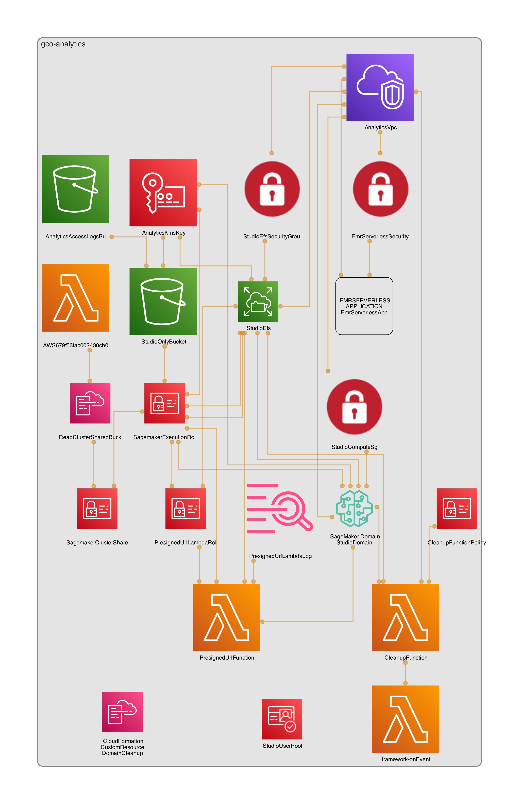

# Analytics Environment

End-to-end guide to the optional GCO analytics environment — a
SageMaker Studio domain plus [EMR Serverless](https://docs.aws.amazon.com/emr/latest/EMR-Serverless-UserGuide/emr-serverless.html), Cognito user pool, and
presigned-URL API gateway route, bolted onto an existing GCO
deployment via a single toggle.

The analytics environment is **off by default**. Enable it only when
you want interactive notebook analytics; the rest of GCO works exactly
the same whether or not it is deployed. The always-on
`Cluster_Shared_Bucket` that cluster jobs read and write is **not**
part of this feature's toggle — it is always on regardless of whether
analytics is enabled. See
[`docs/CLUSTER_SHARED_BUCKET.md`](CLUSTER_SHARED_BUCKET.md) for that
bucket's reference.

## Table of Contents

> **Region placeholders.** The examples throughout this guide use
> `us-east-1` for regional clusters and `us-east-2` for the global /
> API-gateway region. Substitute your own regions wherever they appear
> — check `deployment_regions.regional` and
> `deployment_regions.api_gateway` in your `cdk.json` for the values
> that match your deployment.

- [Cost](#cost)
- [Default image](#default-image)
- [(a) What the analytics environment provisions](#a-what-the-analytics-environment-provisions)
- [(b) Enabling and deploying the stack](#b-enabling-and-deploying-the-stack)
- [(c) Managing Cognito users via the CLI](#c-managing-cognito-users-via-the-cli)
- [(d) Logging into Studio](#d-logging-into-studio)
- [(e) Optional user-driven install of GCO CLI and MCP server](#e-optional-user-driven-install-of-gco-cli-and-mcp-server)
- [(f) Using the GCO CLI once installed inside JupyterLab](#f-using-the-gco-cli-once-installed-inside-jupyterlab)
- [(g) Submitting HyperPod jobs and SageMaker training jobs from Studio](#g-submitting-hyperpod-jobs-and-sagemaker-training-jobs-from-studio)
- [(g2) Launching SageMaker Canvas when the sub-toggle is enabled](#g2-launching-sagemaker-canvas-when-the-sub-toggle-is-enabled)
- [(g3) Tracking experiments with managed MLflow](#g3-tracking-experiments-with-managed-mlflow)
- [(h) Using Kiro with the environment](#h-using-kiro-with-the-environment)
- [(i) Running the example cluster jobs and reading their output from a notebook](#i-running-the-example-cluster-jobs-and-reading-their-output-from-a-notebook)
- [(j) Two-bucket access model](#j-two-bucket-access-model)
- [(k) Studio_EFS and the Studio home directory](#k-studio_efs-and-the-studio-home-directory)
- [(l) The `gco-cluster-shared-bucket` ConfigMap schema](#l-the-gco-cluster-shared-bucket-configmap-schema)
- [(m) Cross-region data-transfer caveat](#m-cross-region-data-transfer-caveat)

## Cost

The analytics environment is **off by default** and incurs zero cost
until you run `gco analytics enable` + `gco stacks deploy gco-analytics`.
When enabled, these resources drive cost:

- **SageMaker Studio** — per-user JupyterLab apps on `ml.t3.medium` by
  default. Charged per app-hour while the app is running. Shut idle
  apps down from the Studio UI to stop the meter.
- **EMR Serverless** — SPARK application, charged per vCPU-hour and
  GB-hour of actual job execution. Zero cost when no jobs are
  running.
- **KMS** — `Analytics_KMS_Key` ($1/month) and `Cluster_Shared_KMS_Key`
  ($1/month if you count it under this feature — it is actually owned
  by `gco-global` and always on). Plus per-request charges on key
  usage.
- **S3** — `Studio_Only_Bucket` and its access-logs bucket. Typical
  notebook usage is sub-dollar; the cost depends on how much data
  you stage.
- **Cognito** — The Lite tier includes 50,000 monthly active users (MAUs) for free (no automatic expiry). Advanced security features on the Essentials and Plus tiers are additional; see the [Amazon Cognito pricing page](https://aws.amazon.com/cognito/pricing/) for current rates. The new tier names (Lite / Essentials / Plus) landed in November 2024, so older blog posts may reference the legacy free-tier structure.
- **Lambda** — The presigned-URL Lambda is invoked once per Studio
  login. Effectively free at human-scale usage. It runs in the analytics
  VPC, to mount `Studio_EFS`, and its network interfaces cost nothing.
- **Studio_EFS** — The EFS file system Studio spaces can attach, one
  directory per user. Charged per GB-month of storage plus per-GB for
  IA-tier transitions.
- **NAT gateway** — The analytics VPC's one NAT gateway, through which
  notebooks reach the internet (pip, git), is charged per hour it
  exists and per GB it processes, whether or not anyone is using Studio.
  See [Amazon VPC pricing](https://aws.amazon.com/vpc/pricing/).
- **VPC endpoints** — The analytics VPC creates interface endpoints
  for `SAGEMAKER_API`, `SAGEMAKER_RUNTIME`, `SAGEMAKER_STUDIO`,
  `SAGEMAKER_NOTEBOOK`, `STS`, `CLOUDWATCH_LOGS`, `ECR`, `ECR_DOCKER`,
  and `ELASTIC_FILE_SYSTEM`. Each interface endpoint is roughly
  $7/month per AZ plus per-GB processing. The gateway endpoint for
  `S3` is free.

To see the running cost:

```bash
gco costs summary --days 7
gco costs regions --days 7
```

Disable the feature at any time with `gco analytics disable` followed
by `gco stacks destroy gco-analytics`. The analytics resources are all
`RemovalPolicy.DESTROY` so destroy cleanly removes them without
orphaned retained resources (see [section (k)](#k-studio_efs-and-the-studio-home-directory) for the opt-in retain
override on `Studio_EFS`).

A cleanup Lambda (`lambda/analytics-cleanup/`) runs automatically as a
CloudFormation custom resource during stack deletion. It removes the
SageMaker user profiles the presigned-URL Lambda created at runtime, with
their spaces and apps, and the per-user EFS access points earlier releases
created — resources CloudFormation doesn't know about because they
weren't in the original template. Control flow:
[interactive HTML](../diagrams/code_diagrams/lambda/analytics-cleanup/handler.handler.html) ·
[PNG](../diagrams/code_diagrams/lambda/analytics-cleanup/handler.handler.png).

## Default image

The Studio domain uses the **stock AWS-published SageMaker
Distribution image**. There is no custom image build, no
`sagemaker.CfnImage` resource, no ECR repository, and no Dockerfiles
in this repo for the Studio runtime. `DefaultUserSettings.JupyterLabAppSettings.CustomImages`
is explicitly empty, and that emptiness is a tested invariant.

If a user needs extra Python packages inside JupyterLab, install them
into `/home/sagemaker-user` using `pip install --user`:

```bash
pip install --user pandas pyarrow duckdb
```

`/home/sagemaker-user` is on the space's own storage volume, not on
`Studio_EFS` (see [section (k)](#k-studio_efs-and-the-studio-home-directory)), so packages installed this way **persist
across restarts of that space**; a new space starts without them. No
container image rebuild is required, and no operator intervention is
needed to support new libraries.

System-level tooling (for example, a binary published via `apt`) is
out of scope for this feature — use a shell-out to `subprocess` or a
vendored wheel instead.

## (a) What the analytics environment provisions

<details>
<summary>📊 Analytics stack architecture diagram (click to expand)</summary>



*Auto-generated from the CDK app via cdk-dia. Regenerate with `python diagrams/infra_diagrams/generate.py --stack analytics`.*

</details>

When `analytics_environment.enabled=true` and `gco-analytics` is
deployed, the following resources appear in the API-gateway region
(default `us-east-2`):

- **SageMaker Studio domain** (`gco-analytics-domain`) with
  `auth_mode=IAM` and `app_network_access_type=VpcOnly`. No public
  network exposure for notebooks.
- **EMR Serverless application** (`SPARK` type) pinned to
  `EMR_SERVERLESS_RELEASE_LABEL` from
  [`gco/stacks/constants.py`](../gco/stacks/constants.py).
  Once deployed, the application is visible from the Studio Data
  panel:

  

  Studio notebooks can submit Spark jobs to this application without
  any additional IAM plumbing. The SageMaker execution role carries
  the full submission surface
  (`emr-serverless:StartJobRun`, `GetJobRun`, `ListJobRuns`,
  `CancelJobRun`, `GetDashboardForJobRun`, `AccessLivyEndpoints`,
  plus the lifecycle actions on `Application`) so three paths work
  out of the box:

  1. **Studio's "Run on EMR Serverless" tile** — click-to-run from
     the Data panel; Studio auto-discovers the application in the
     same account/region and wires the presigned Livy endpoint for
     you. No code change to the notebook required.
  2. **SparkMagic `%%spark` kernel** — the built-in PySpark kernel
     uses `AccessLivyEndpoints` to open a remote Spark session on
     the EMR Serverless app and executes cells against it.
  3. **Native `boto3`** — for scripted pipelines, call
     `boto3.client("emr-serverless").start_job_run(...)` with the
     application id (`list_applications()` returns it; the
     application is named `<project_name>-spark-<region>`)
     and `executionRoleArn=` set to the role the Studio kernel is
     already assuming. Job inputs can come from either
     `Cluster_Shared_Bucket` (cross-region read via the SageMaker
     role's grant) or `Studio_Only_Bucket`, and outputs can write
     back to either — no extra per-user IAM configuration needed.

  The application configures no pre-initialized capacity, so billing
  is per job run: the vCPU, memory and storage the run's workers use
  while they run. Nothing is charged while no job runs. See the
  [EMR Serverless pricing page](https://aws.amazon.com/emr/serverless/pricing/)
  for the current per-vCPU and per-GB rates.

- **SageMaker-managed [MLflow](https://mlflow.org/docs/latest/index.html) + MLflow Apps** — the SageMaker
  execution role is attached to the AWS-managed
  `AmazonSageMakerFullAccess` policy (always on when
  `analytics_environment.enabled=true`), plus an inline
  `sagemaker-mlflow:*` statement scoped to the api-gateway region.
  The managed policy covers both MLflow surfaces in Studio —
  the classic **MLflow Tracking Servers** (`sagemaker:*Mlflow*`
  control-plane actions) and the newer **MLflow Apps**
  (`sagemaker:CreateMlflowApp` / `ListMlflowApps` /
  `DescribeMlflowApp`) — along with the SageMaker Model Registry
  (`sagemaker:*ModelPackage*`) that MLflow's `register_model`
  round-trips through. The inline `sagemaker-mlflow:*` statement
  covers the data-plane namespace the MLflow SDK's [SigV4](https://docs.aws.amazon.com/IAM/latest/UserGuide/reference_sigv.html) plug-in
  talks to (`log_metric`, `log_artifact`, `register_model`, etc.)
  — that service prefix is not in the managed policy. Notebook
  users can spin up a tracking server, log experiments, and
  register models directly from a Studio cell; Canvas's "Register
  model" flow writes to the same Model Registry. GCO does not
  pre-create the tracking server or app itself — the first
  `sagemaker.client.create_mlflow_tracking_server(...)` or
  `create_mlflow_app(...)` call (typically from `%%sh` or `boto3`
  inside a notebook) brings one up; the server / app is billed
  per hour it's running. See [section (g3)](#g3-tracking-experiments-with-managed-mlflow)
  for the end-to-end notebook workflow.

- **Cognito user pool** with a strong password policy (12+ chars,
  digits/symbols/uppercase required), an app client that allows the
  `ADMIN_USER_PASSWORD_AUTH` flow `gco analytics studio login` uses
  (and SRP), and a hosted
  `UserPoolDomain` at prefix `gco-studio-<account>`.
- **Analytics VPC** — private subnets for Studio, EMR Serverless and the
  endpoints, and public subnets that hold only the NAT gateway notebooks
  reach the internet through (pip, git); interface endpoints for the
  SageMaker, STS, CloudWatch Logs, ECR, and EFS services and a gateway
  endpoint for S3. It has no VPC flow log (the regional VPCs do).
- **Studio_EFS** — encrypted EFS file system that Studio spaces can
  attach; each user profile the presigned-URL Lambda creates sees
  `/home/<username>` on it, which the Lambda creates
  ([section (k)](#k-studio_efs-and-the-studio-home-directory)).
- **Studio_Only_Bucket** — KMS-encrypted S3 bucket scoped to the
  SageMaker execution role only. Not accessible from cluster pods.
  Comes with a dedicated access-logs bucket.
- **Analytics_KMS_Key** — customer-managed KMS key encrypting the
  VPC's logs, Studio_Only_Bucket, Studio_EFS, and the Cognito user
  pool's message attributes.
- **SageMaker_Execution_Role** — role name begins with
  `AmazonSageMaker-gco-analytics-exec-<region>` (SageMaker requires
  the prefix). Granted RW on `Studio_Only_Bucket` and
  `Cluster_Shared_Bucket`, plus invoke rights on the GCO API for
  job/inference submission, plus the SageMaker-managed MLflow +
  Model Registry API surface (tracking-server lifecycle, MLflow
  experiments/runs/metrics/artifacts/models, and Model Registry
  read/write). When the `canvas` sub-toggle is
  on, the role additionally gets the AWS-managed
  `AmazonSageMakerCanvasFullAccess` policy (see [section (g2)](#g2-launching-sagemaker-canvas-when-the-sub-toggle-is-enabled)).
- **Presigned-URL Lambda** — the backend for the `/studio/login`
  API Gateway route. Calls
  `CreatePresignedDomainUrl` and creates per-user profiles on first
  login. Full control-flow diagram:
  [interactive HTML](../diagrams/code_diagrams/lambda/analytics-presigned-url/handler.lambda_handler.html) ·
  [PNG](../diagrams/code_diagrams/lambda/analytics-presigned-url/handler.lambda_handler.png).
- **API Gateway `/studio/*` routes** — grafted onto the existing
  `gco-api-gateway` via an `analytics_config` constructor parameter
  (no second API Gateway). The `/studio/login` route uses Cognito
  authorization; the existing `/api/v1/*` and `/inference/*` routes
  keep IAM authorization unchanged.

When `analytics_environment.enabled=false`, none of these resources
exist. The regional stacks and the always-on `Cluster_Shared_Bucket`
are unaffected.

## (b) Enabling and deploying the stack

Two commands, in order:

```bash
gco analytics enable
gco stacks deploy gco-analytics
```

`gco analytics enable` flips `analytics_environment.enabled` to `true`
in `cdk.json` and prints the follow-up deploy command — it does not
deploy automatically. This is deliberate: you review the diff, then
decide to apply.

`--hyperpod` still sets `analytics_environment.hyperpod.enabled=true`,
but it is deprecated and changes nothing: the SageMaker execution role
can already start SageMaker training jobs, and HyperPod work goes through
GCO. See [section (g)](#g-submitting-hyperpod-jobs-and-sagemaker-training-jobs-from-studio).

With SageMaker Canvas:

```bash
gco analytics enable --canvas
gco stacks deploy gco-analytics
```

The `--canvas` flag additionally sets
`analytics_environment.canvas.enabled=true`, which attaches the
AWS-managed `AmazonSageMakerCanvasFullAccess` policy to the SageMaker
execution role. The policy is sufficient for Canvas to surface on the
Studio landing page — SageMaker auto-detects the entitlement when a
user opens Studio and lights up the Canvas tile. See [section (g2)](#g2-launching-sagemaker-canvas-when-the-sub-toggle-is-enabled)
for the walkthrough.

Skip the confirmation prompt with `-y`:

```bash
gco analytics enable -y
gco analytics enable --canvas -y
```

Run the pre-flight checks before deploying:

```bash
gco analytics doctor
```

`doctor` verifies that `gco-global`, `gco-api-gateway`, and every
regional stack listed in `deployment_regions.regional` are deployed
(`CREATE_COMPLETE`, `UPDATE_COMPLETE` or `IMPORT_COMPLETE`); that the
three `/gco/cluster-shared-bucket/*` SSM
parameters are present in the global region; and that no orphaned
analytics resources are left over from a previous retain-policy
destroy. Exits non-zero on any failure, with a remediation line per
check.

Deploy takes about 15-20 minutes end-to-end. When it succeeds,
`gco stacks deploy gco-analytics` redeploys `gco-api-gateway` itself,
which adds the `/studio/*` routes to the existing REST API (the API
Gateway stack imports the Cognito pool and the presigned-URL Lambda
from the analytics stack), and `gco stacks deploy-all` deploys
`gco-api-gateway` after `gco-analytics` anyway. Only a plain
`cdk deploy gco-analytics` leaves that step to you:

```bash
gco stacks deploy gco-api-gateway
```

Check status at any time:

```bash
gco analytics status
```

This prints the current `cdk.json` toggle state and the deployment
state of `gco-analytics`. Useful for confirming whether the stack is
enabled/deployed, disabled/deployed (about to be destroyed), or
disabled/undeployed (the steady state when unused).

Disable and tear down:

```bash
gco analytics disable
gco stacks destroy gco-analytics
```

The destroy takes about 20 minutes: before CloudFormation can delete the
presigned-URL Lambda, which runs in the analytics VPC, Lambda has to
release the function's network interfaces (19 of the 21 minutes in a
test teardown).

`disable` leaves the `hyperpod`, `canvas`, `cognito`, and `efs`
sub-blocks untouched so a subsequent `enable` preserves your
preferences.

## (c) Managing Cognito users via the CLI

The analytics CLI wraps the Cognito admin APIs so you never need the
AWS console to onboard users. All commands auto-discover the user-pool
ID from the `gco-analytics` CloudFormation outputs.

Create a user:

```bash
gco analytics users add --username alice --email alice@example.com
```

The username also names the user's SageMaker Studio user profile, so
`users add` accepts only names SageMaker accepts there: letters, digits
and hyphens, starting and ending with a letter or digit, 63 characters
at most (`alice-smith`, not `alice.smith` or `alice_smith`). It also
refuses a name that differs only in case from an existing user's:
Cognito keeps `Alice` and `alice` apart, but SageMaker matches profile
names without regard to case, so the two would share one profile name.

The command calls `cognito-idp:AdminCreateUser` with a temporary password
it generates (Cognito never returns one it generates itself), prints that
password exactly once to stdout, and (by default) has Cognito email its
invitation, which carries the same password, to the address on file. The
user chooses a new password at the first `gco analytics studio login` (see
[section (d)](#d-logging-into-studio)). Suppress the email with `--no-email`
— useful when you want to hand the credentials over out-of-band:

```bash
gco analytics users add --username bob --email bob@example.com --no-email
```

Example output:

```text
✓ Created Cognito user: alice
ℹ Temporary password (printed exactly once): Tmp#V2xQ!f1yPq
ℹ Cognito also emailed it to alice@example.com in its invitation.
ℹ The user chooses a new password at the first `gco analytics studio login`.
```

`--password` or `--generate-password` gives the user a permanent password
instead, so the first sign-in needs no new one; Cognito then sends no
invitation, which would carry a temporary password that no longer works.

List users:

```bash
gco analytics users list
gco analytics users list --as-json
```

The default output is a formatted table via the existing
`OutputFormatter`. `--as-json` emits a JSON array for scripting.

Remove a user:

```bash
gco analytics users remove --username alice
gco analytics users remove --username alice --yes
```

The first form prompts for confirmation. `--yes` skips the prompt.
The command deletes the user's Studio user profile first, with the
spaces it owns and their apps (SageMaker deletes a profile only after
them, so this can take a few minutes), and then the Cognito user. The
user's home directory on `Studio_EFS` stays. When the profile cannot be
deleted, the Cognito user is kept and the command exits `1`, so it can
be run again; `--keep-studio-profile` deletes only the Cognito user.
The profile deletion needs `sagemaker:DescribeUserProfile`, `ListTags`,
`ListSpaces`, `ListApps`, `DeleteApp`, `DescribeSpace`, `DeleteSpace` and
`DeleteUserProfile` besides `cognito-idp:AdminGetUser` and `AdminDeleteUser`.

Each profile the Lambda creates carries a `gco:analytics:cognito-sub`
tag holding the Cognito `sub` (the user's immutable ID) of the user it
was created for, and the Lambda serves a profile only to that user.
`users remove` likewise deletes only a profile tagged with the removed
user's `sub` (or untagged), and names one tagged for another user. A
profile left behind by `--keep-studio-profile`, or by `users remove` in an
earlier release, makes a new user given the same name get an HTTP 403 at
login until it is deleted, instead of the old user's profile; delete its
apps and spaces and then the profile with `aws sagemaker delete-app`,
`delete-space` and `delete-user-profile`. A profile without the tag
(created before the Lambda tagged profiles, or outside it) is tagged for
the first user who logs in to it.

Error path — when `gco-analytics` is not deployed:

```bash
gco analytics users list
```

Output:

```text
✗ gco-analytics stack not deployed — run `gco analytics enable` then
  `gco stacks deploy gco-analytics`
```

## (d) Logging into Studio

```bash
gco analytics studio login --username alice
```

The command prompts for the password (use `--password <p>` or set
`$GCO_STUDIO_PASSWORD` to pass it non-interactively — for example in
CI), signs in to the Cognito user pool with `AdminInitiateAuth`
(`AuthFlow=ADMIN_USER_PASSWORD_AUTH`), retrieves the Cognito `AccessToken`,
and exchanges it for a SageMaker Studio presigned URL via
`GET {API_Gateway_URL}/prod/studio/login`.

`AdminInitiateAuth` is an administrator API, so the command needs AWS
credentials as well as the Cognito password: `cognito-idp:AdminInitiateAuth`
(and `AdminRespondToAuthChallenge` for a first sign-in) on the pool, and
`cloudformation:DescribeStacks` on `gco-analytics` and `gco-api-gateway`,
whose outputs name the pool, its app client and the API.

The first sign-in of a user created without a permanent password uses the
temporary password from `users add`, and Cognito then asks for a new one.
Pass it with `--new-password` (or `$GCO_STUDIO_NEW_PASSWORD`), or let the
command ask for it twice on a terminal; it must meet the pool's policy (12
characters or more, with upper and lower case letters, a digit and a
symbol) and becomes the user's password:

```bash
gco analytics studio login --username alice --new-password 'Chosen!Passw0rd'
```

The URL is printed on its own line on stdout so it's pipe-friendly.
Add `--open` to launch the default browser automatically:

```bash
gco analytics studio login --username alice --open
```

Override the API endpoint if auto-discovery can't find it (the pool
and its app client are still read from the `gco-analytics` stack's
outputs):

```bash
gco analytics studio login \
  --username alice \
  --api-url https://abc123.execute-api.us-east-2.amazonaws.com
```

The password, the Cognito tokens, and the Studio URL are never written to
disk. If login fails, the CLI prints the Cognito error code (for
example `NotAuthorizedException`, `UserNotFoundException`) or the
HTTP status, the Lambda's error token and the correlation ID from the
`/studio/login` call, and exits with status 1 or 2 respectively. For
`UnsupportedUsername` and `UserProfileOwnedByAnotherUser` it also says
what an administrator has to do (create a user with a supported name,
or delete the old profile). A `401` with no error token is API Gateway
refusing the token before the Lambda runs; from a CLI of this release
it usually means `<project>-api-gateway` was deployed by an earlier
release, which accepts only an ID token, and the CLI says to redeploy it.

Login flow:

1. CLI calls `AdminInitiateAuth` with
   `AuthFlow=ADMIN_USER_PASSWORD_AUTH`, signed with your AWS
   credentials; the username and password travel to Cognito over TLS.
2. Cognito returns an `AuthenticationResult` containing `IdToken`,
   `AccessToken`, and `RefreshToken`. A user whose password is still
   temporary gets a `NEW_PASSWORD_REQUIRED` challenge instead, which
   the CLI answers with `AdminRespondToAuthChallenge` and the new
   password; Cognito then returns the `AuthenticationResult`.
3. CLI sends the `AccessToken` in the `Authorization` header to
   `/studio/login`. API Gateway's Cognito authorizer validates the
   JWT against the user-pool ARN and requires the
   `aws.cognito.signin.user.admin` scope, so it accepts only an access
   token: an ID token has no `scope` claim and gets a `401`. Cognito
   puts exactly that one scope in the access tokens `AdminInitiateAuth`
   issues; a custom scope would need the hosted sign-in pages or an
   access-token trigger, which the pool's Lite feature plan does not
   offer.
4. Presigned-URL Lambda reads the Studio domain id from its
   environment and creates the user profile if it doesn't exist
   (replacing a `Failed` one), tagged with the caller's Cognito `sub`.
   A username SageMaker cannot use as a profile name is a `400`
   (`UnsupportedUsername`), and a profile whose tag names another user
   is a `403` (`UserProfileOwnedByAnotherUser`). While the profile
   provisions it answers `202` and the CLI polls; a profile it cannot
   recover is a `409` (`UserProfileFailed`). Once the profile is
   `InService` it calls `CreatePresignedDomainUrl` with a 300-second
   expiry.
5. Lambda returns `{url, expires_in}`; API Gateway returns it to
   the CLI; the CLI prints `url` on its own line.

The URL expires in 5 minutes — open it promptly.

After opening the URL, Studio presents the landing screen where you
can create or open a JupyterLab space:


Click into a JupyterLab space to open the notebook IDE:


The JupyterLab landing page shows the file browser and launcher:


## (e) Optional user-driven install of GCO CLI and MCP server

Nothing in this section is installed by CDK. Every step below is
**manual, user-driven, and runs from inside a JupyterLab terminal**
on the SageMaker Studio instance. The CDK deploy only provisions the
Studio domain and the user profile; the tooling inside the notebook
is yours to install.

### Installing the GCO CLI inside SageMaker Studio

GCO needs Python 3.14 or later, and the SageMaker Distribution images run
an older Python (3.13 in SageMaker Distribution 5.x, see the image's
[`cpu.env.in`](https://github.com/aws/sagemaker-distribution/blob/main/build_artifacts/v5/v5.1/v5.1.0/cpu.env.in)),
so `pip install` of GCO fails there. Install it with
[`uv`](https://docs.astral.sh/uv/) instead, which downloads a managed
Python 3.14 for it. Open a JupyterLab terminal (`File` → `New` → `Terminal`)
and run:

```bash
# SageMaker Distribution 5.x includes uv; on an image without it: pip install --user uv
GCO_REF=v9.3.0   # the GCO release your deployment runs
uv tool install --python 3.14 "git+https://github.com/aws-solutions-library-samples/global-capacity-orchestrator-on-aws.git@${GCO_REF}"
```

That installs the `gco` and `gco-mcp` commands into `~/.local/bin`. The
example manifests the sections below submit are not part of the install;
clone the same release for them:

```bash
git clone --depth 1 --branch "${GCO_REF}" https://github.com/aws-solutions-library-samples/global-capacity-orchestrator-on-aws ~/gco
```


The install and the clone live in your home directory,
`/home/sagemaker-user`, which is on the space's own storage volume (see
[section (k)](#k-studio_efs-and-the-studio-home-directory)), so they survive restarts of the space. A new space starts
without them.

Point the CLI at your deployment. Add these to `~/.bashrc` so they
survive terminal restarts (replace the values with your own — see the
note at the top of this guide):

```bash
cat >> ~/.bashrc <<'BASHRC_EOF'
export PATH="$HOME/.local/bin:$PATH"
export GCO_PROJECT_NAME=gco
export GCO_API_GATEWAY_REGION=us-east-2
export GCO_DEFAULT_REGION=us-east-1
BASHRC_EOF
source ~/.bashrc
```

The CLI discovers the API URL itself from the `ApiEndpoint` output of the
`gco-api-gateway` stack, so `GCO_API_GATEWAY_REGION` only needs to name the
region that stack lives in (your `deployment_regions.api_gateway`).
`GCO_DEFAULT_REGION` should point at the regional cluster you want the CLI
to talk to by default — typically the region closest to the Studio domain.
`GCO_PROJECT_NAME` is your `cdk.json` `project_name`. Run `gco` from your
home directory rather than from `~/gco`: in a directory holding a
`cdk.json`, the CLI reads the project name and Regions from that file, and
the clone's `cdk.json` is the shipped default, not your deployment's.

Verify:

```bash
gco --help
gco jobs list --all-regions
```

What the Studio execution role lets the CLI do:

- The `gco jobs` commands that go through the GCO API: `submit` (with or
  without `-r`), `list`, `get`, `logs` and `delete`. The role may call the
  global API and each workload Region's regional API (where a command with
  `-r` goes), and read this project's CloudFormation stacks, whose outputs
  name those APIs.
- The fallback `gco jobs logs` uses for a job whose pods are gone: a
  CloudWatch Logs Insights query of the job Region's Container Insights
  application log group (`logs:StartQuery` on that log group and
  `logs:GetQueryResults`).
- Not the commands that call AWS services directly instead of the API, for
  example `gco jobs submit-direct` (kubectl), `gco jobs submit-sqs` (EC2
  and SQS), `gco inference deploy` (DynamoDB) and `gco capacity status` or
  `gco capacity recommend-region` (SQS, EC2 and Pricing). Run those from a
  workstation with credentials that allow them.

### Optional: wiring GCO's MCP server into the Studio coding assistant

The `uv tool install` above also installs the GCO MCP server as the
`gco-mcp` command. Register it with the assistant as a stdio server with no
arguments; the absolute path keeps it working when the assistant's
environment does not have `~/.local/bin` on its `PATH`:

```json
{
  "mcpServers": {
    "gco": {
      "command": "/home/sagemaker-user/.local/bin/gco-mcp",
      "env": {
        "GCO_PROJECT_NAME": "gco",
        "GCO_API_GATEWAY_REGION": "us-east-2",
        "GCO_DEFAULT_REGION": "us-east-1"
      }
    }
  }
}
```

Where that block goes depends on the assistant:

- **Kiro**, the default assistant in the JupyterLab chat panel on
  SageMaker Distribution 4.1 and later
  ([Using a coding assistant](https://docs.aws.amazon.com/sagemaker/latest/dg/studio-updated-jl-coding-assistant.html)),
  reads `~/.kiro/settings/mcp.json`.
- **Amazon Q Developer** in Code Editor keeps globally configured MCP
  servers in `~/.aws/amazonq/default.json`
  ([MCP configuration for Q Developer in the IDE](https://docs.aws.amazon.com/amazonq/latest/qdeveloper-ug/mcp-ide.html)).
  Add the server from its MCP configuration panel (command
  `/home/sagemaker-user/.local/bin/gco-mcp`, no arguments) rather than
  editing that file by hand.

This is **manual and user-driven, not part of the CDK deploy**; the CDK
code knows nothing about either assistant. The server runs with the
Studio execution role, so its tools can do what the CLI can (see the list
above). Start a new chat session after adding it so the assistant loads
the server.

## (f) Using the GCO CLI once installed inside JupyterLab

With the CLI installed and the environment variables set per [section (e)](#e-optional-user-driven-install-of-gco-cli-and-mcp-server),
the `gco jobs` commands that go through the GCO API work from a
JupyterLab terminal or from a notebook cell via `!` shell-out. The
examples read the manifests from the clone in `~/gco`; replace
`-r us-east-1` with your regional cluster region.

Submit a job to a cluster:

```bash
gco jobs submit ~/gco/examples/cluster-shared-bucket-upload-job.yaml -r us-east-1
```

List jobs across all regions:

```bash
gco jobs list --all-regions
```

Tail logs for a specific job:

```bash
gco jobs logs cluster-shared-bucket-upload -r us-east-1 -n gco-jobs
```

These commands work the same from a workstation. Capacity
recommendations (`gco capacity recommend-region`), inference endpoints
(`gco inference deploy`) and the other commands [section (e)](#e-optional-user-driven-install-of-gco-cli-and-mcp-server) lists as
needing workstation credentials are run from a workstation.

## (g) Submitting HyperPod jobs and SageMaker training jobs from Studio

`analytics_environment.hyperpod.enabled`, which
`gco analytics enable --hyperpod` sets, is deprecated and changes nothing.
It used to add SageMaker training-job and cluster-node actions to the
SageMaker execution role, all of which the role's `AmazonSageMakerFullAccess`
policy already allows (two of them were not IAM actions at all). Neither way
of training from Studio below depends on it, and a `cdk.json` that still sets
it synthesizes unchanged.

### HyperPod jobs, through GCO

In GCO, [SageMaker HyperPod](HYPERPOD.md) is capacity of a regional EKS
cluster: a Region whose `cdk.json` `hyperpod` block is on runs a HyperPod
cluster whose instance groups join the EKS cluster as nodes, behind the
`gco-hyperpod` Kueue queue. Work reaches those nodes as an ordinary
Kubernetes Job that carries the queue's label, and Kueue adds the node
selector and toleration. [HYPERPOD.md → How work reaches HyperPod
nodes](HYPERPOD.md#how-work-reaches-hyperpod-nodes) has a complete manifest;
the part that routes it is:

```yaml
metadata:
  namespace: gco-jobs
  labels:
    kueue.x-k8s.io/queue-name: gco-hyperpod
```

Submit it from a Studio terminal through the GCO API like any other job
([section (e)](#e-optional-user-driven-install-of-gco-cli-and-mcp-server) covers the install and what the Studio role allows), naming a
Region that runs HyperPod:

```bash
gco jobs submit train-on-hyperpod.yaml -r us-east-1
gco jobs logs train-on-hyperpod -r us-east-1 -n gco-jobs
```

### SageMaker training jobs, from a notebook

A SageMaker training job runs on instances SageMaker manages, not on a GCO
cluster, and works whether or not any Region runs HyperPod. The execution
role can start one with `boto3` from a notebook: `AmazonSageMakerFullAccess`
allows `CreateTrainingJob` and passing a role whose name contains
`AmazonSageMaker` to SageMaker, which this role's does.

```python
import boto3

region = boto3.Session().region_name  # the Studio domain's Region
account = boto3.client("sts").get_caller_identity()["Account"]
sm = boto3.client("sagemaker", region_name=region)

response = sm.create_training_job(
    TrainingJobName="exploration-run-001",
    AlgorithmSpecification={
        # A Deep Learning Containers image from the job's own Region.
        "TrainingImage": (
            f"763104351884.dkr.ecr.{region}.amazonaws.com/"
            "pytorch-training:2.4.0-gpu-py311-cu124-ubuntu22.04-sagemaker"
        ),
        "TrainingInputMode": "File",
    },
    # The execution role: AmazonSageMaker-<project_name>-analytics-exec-<region>.
    RoleArn=f"arn:aws:iam::{account}:role/AmazonSageMaker-gco-analytics-exec-{region}",
    InputDataConfig=[
        {
            "ChannelName": "training",
            "DataSource": {
                "S3DataSource": {
                    "S3DataType": "S3Prefix",
                    "S3Uri": "s3://gco-global-clustersharedbucket1a2b3c4d-x1y2z3w4v5u6/training-data/",
                    "S3DataDistributionType": "FullyReplicated",
                }
            },
        }
    ],
    OutputDataConfig={
        "S3OutputPath": "s3://gco-global-clustersharedbucket1a2b3c4d-x1y2z3w4v5u6/training-output/",
    },
    ResourceConfig={
        "InstanceType": "ml.p4d.24xlarge",
        "InstanceCount": 2,
        "VolumeSizeInGB": 100,
    },
    StoppingCondition={"MaxRuntimeInSeconds": 3600},
)
print(response["TrainingJobArn"])
```

Notes:

- Deep Learning Containers images are published per Region; pick the
  image URI for the job's Region from the
  [available images list](https://github.com/aws/deep-learning-containers/blob/master/available_images.md)
  (the `763104351884` account serves most commercial Regions, not all).
- `Cluster_Shared_Bucket` works as both input and output because
  the SageMaker role has RW on it (always, whenever analytics is
  enabled). Replace the bucket name with your deployment's
  (`/gco/cluster-shared-bucket/name` in SSM, see [section (i)](#i-running-the-example-cluster-jobs-and-reading-their-output-from-a-notebook)).
- Multi-node training is the same call with `InstanceCount > 1`. To let the
  training containers reach something inside the analytics VPC, such as
  `Studio_EFS`, run the job in that VPC with `VpcConfig` (the analytics
  VPC's private subnets and a security group the resource admits); no VPC
  peering is involved.

## (g2) Launching SageMaker Canvas when the sub-toggle is enabled

When `analytics_environment.canvas.enabled=true` (flipped via
`gco analytics enable --canvas`), the analytics stack attaches the
AWS-managed `AmazonSageMakerCanvasFullAccess` policy to
`SageMaker_Execution_Role`. This is the managed policy that AWS
publishes specifically for Canvas — it grants the full Canvas
permission surface (Bedrock for generative AI, Forecast for time
series, Rekognition for image classification, [Athena](https://docs.aws.amazon.com/athena/latest/ug/what-is.html) for SQL
sources, S3 writes for datasets, and so on). Using the managed
policy means we pick up new Canvas capabilities automatically as
AWS ships them. The corresponding `AwsSolutions-IAM4` nag finding
carries a scoped suppression that explains the trade-off.

Studio users open Canvas from the Studio landing page once the stack
is deployed — no CLI-side setup is required on the user's behalf.
SageMaker auto-detects the Canvas entitlement on the execution role
and lights up the Canvas tile; the first click provisions a per-user
Canvas backend, subsequent launches reuse it.

Once inside Canvas, the Data Wrangler tab is the typical
starting point — notebook-free dataset import, transformation,
and feature-engineering on top of the `Studio_Only_Bucket` or
`Cluster_Shared_Bucket` (notebooks can stage data via `boto3`
first, then point Canvas at the S3 URI):


Canvas workspaces use Canvas's own default artifact locations
(typically a Canvas-managed S3 bucket in the analytics region).
Per-feature Canvas configuration — workspace S3 artifact path,
Bedrock role for generative AI, time-series forecasting settings,
direct-deploy / model-register defaults — is the `CanvasAppSettings`
block of the SageMaker API's user settings (`CreateDomain`,
`CreateUserProfile`, `UpdateUserProfile`). CloudFormation's
`AWS::SageMaker::Domain` and `AWS::SageMaker::UserProfile` take no such
property, so GCO cannot set it from CDK; pin defaults with
`aws sagemaker update-user-profile --user-settings` on a profile (or
`update-domain --default-user-settings` for the domain).

Disable Canvas later by flipping the sub-toggle off in `cdk.json`
and redeploying `gco-analytics`:

```bash
python3 -c "import json; d=json.load(open('cdk.json')); d['context']['analytics_environment']['canvas']['enabled']=False; json.dump(d, open('cdk.json','w'), indent=2)"
gco stacks deploy gco-analytics
```

## (g3) Tracking experiments with managed MLflow

MLflow is always on whenever `analytics_environment.enabled=true` —
no sub-toggle required. The SageMaker execution role has the
AWS-managed `AmazonSageMakerFullAccess` policy attached, which
covers both the classic **MLflow Tracking Servers** and the newer
**MLflow Apps** control plane, plus an inline `sagemaker-mlflow:*`
statement covering the data-plane namespace the MLflow SDK's SigV4
plug-in uses to write experiments, runs, metrics, artifacts, and
registered-model versions.

End-to-end flow from a Studio notebook:

1. **Install the SageMaker MLflow SigV4 plug-in** (not pre-installed
    on stock SageMaker Distribution images):

    ```bash
    pip install sagemaker-mlflow mlflow
    ```

2. **Create a tracking server** from the notebook. The server is
    billed per hour it's running; delete it when you're done.

    ```python
    import boto3

    region = boto3.Session().region_name
    sm = boto3.client("sagemaker", region_name=region)
    bucket = boto3.client("ssm", region_name=region).get_parameter(
        Name="/gco/cluster-shared-bucket/name"
    )["Parameter"]["Value"]

    sm.create_mlflow_tracking_server(
        TrackingServerName="gco-mlflow",
        ArtifactStoreUri=f"s3://{bucket}/mlflow/",
        TrackingServerSize="Small",
        RoleArn=sm.describe_domain(DomainId="d-<your-domain-id>")["DefaultUserSettings"][
            "ExecutionRole"
        ],
    )
    ```

    Wait for the server to report `Created` (a few minutes on
    first provision):

    ```python
    import time

    while True:
        status = sm.describe_mlflow_tracking_server(TrackingServerName="gco-mlflow")[
            "TrackingServerStatus"
        ]
        print(status)
        if status in ("Created", "CreateFailed"):
            break
        time.sleep(30)
    ```

3. **Log your first experiment.** Point MLflow at the tracking
    server ARN and the SigV4 plug-in handles auth automatically:

    ```python
    import mlflow

    tracking_arn = sm.describe_mlflow_tracking_server(TrackingServerName="gco-mlflow")[
        "TrackingServerArn"
    ]
    mlflow.set_tracking_uri(tracking_arn)
    mlflow.set_experiment("my-first-experiment")

    with mlflow.start_run(run_name="baseline"):
        mlflow.log_param("learning_rate", 0.01)
        mlflow.log_param("epochs", 10)
        mlflow.log_metric("train_loss", 0.42, step=0)
        mlflow.log_metric("val_loss", 0.55, step=0)
        mlflow.log_artifact("confusion_matrix.png")
    ```

4. **Browse runs in Studio.** Open the **Experiments** panel from
    the Studio sidebar and pick your tracking server. The SageMaker
    Studio MLflow UI lands on the experiment-tracking view:

    

    From here you can compare runs, inspect metrics over time, and
    drill into artifacts. The same view is reachable from MLflow
    Apps (a lighter-weight alternative to tracking servers — faster
    startup, cross-account sharing) via `create_mlflow_app(...)` if
    you prefer not to manage a long-running server.

5. **Register a model to the SageMaker Model Registry.** MLflow's
    `register_model` round-trips through
    `sagemaker:CreateModelPackage` — covered by the managed policy —
    so Canvas's "Register model" flow and MLflow's
    `register_model` write to the same registry:

    ```python
    mlflow.register_model(
        model_uri=f"runs:/{run_id}/model",
        name="my-first-experiment",
    )
    ```

6. **Stop the tracking server when you're done** to avoid idle
    charges:

    ```python
    sm.stop_mlflow_tracking_server(TrackingServerName="gco-mlflow")
    ```

## (h) Using Kiro with the environment

[Kiro](https://kiro.dev) works with the analytics environment in two ways,
and neither needs anything from the CDK deploy.

**In the JupyterLab chat panel.** On SageMaker Distribution 4.1 and later,
Kiro is the assistant the JupyterLab chat panel is set up with
([Using a coding assistant](https://docs.aws.amazon.com/sagemaker/latest/dg/studio-updated-jl-coding-assistant.html)):

1. Sign in to Studio as [section (d)](#d-logging-into-studio) shows and
    open a JupyterLab space.
2. Open the chat panel from the right sidebar and choose `@Kiro`. The
    first time, sign in to Kiro from a JupyterLab terminal:

    ```bash
    kiro-cli login --use-device-flow
    ```

    Kiro has its own sign-in (AWS Builder ID, Google or GitHub, or a Pro
    license); the Cognito user does not sign you in to Kiro.
3. To give Kiro the GCO tools, install the CLI and register the MCP server
    in `~/.kiro/settings/mcp.json` as
    [section (e)](#e-optional-user-driven-install-of-gco-cli-and-mcp-server)
    describes, then start a new chat. The server runs in the space with the
    Studio execution role, so its tools can do what the CLI can there.

**From the Kiro IDE on your machine.** SageMaker AI can open a Studio space
in a local IDE, Kiro included, over Session Manager
([Connect your Remote IDE to SageMaker spaces](https://docs.aws.amazon.com/sagemaker/latest/dg/remote-access.html)).
That needs `sagemaker:StartSession` on the space for the AWS identity on your
machine and **Remote Access** turned on for the space
([Set up remote access](https://docs.aws.amazon.com/sagemaker/latest/dg/remote-access-remote-setup.html)).
The analytics stack grants and configures neither: its users sign in through
Cognito and have no IAM identity of their own. Remote IDE access is
therefore something an administrator sets up for IAM users or roles,
outside GCO.

## (i) Running the example cluster jobs and reading their output from a notebook

Three example manifests ship with the repo specifically for this
workflow. See
[`docs/CLUSTER_SHARED_BUCKET.md`](CLUSTER_SHARED_BUCKET.md#consuming-from-job-manifests)
for their full descriptions.

End-to-end example — cluster writes, notebook reads:

**Step 1 — submit the upload job from a CLI** (from your workstation
or from a JupyterLab terminal once [section (e)](#e-optional-user-driven-install-of-gco-cli-and-mcp-server) is done):

```bash
gco jobs submit ~/gco/examples/analytics-s3-upload-job.yaml -r us-east-1
```

The job reads the `gco-cluster-shared-bucket` ConfigMap via
`envFrom`, uploads a small CSV + schema manifest under
`s3://$sharedBucketName/analytics-data/`, and exits. Takes about 30
seconds end-to-end.

**Step 2 — wait for the job to complete**:

```bash
gco jobs list -r us-east-1 -n gco-jobs
gco jobs logs analytics-s3-upload -r us-east-1 -n gco-jobs
```

**Step 3 — read the output from a Studio notebook cell**:

```python
import boto3
import pandas

# The Studio execution role has RW on Cluster_Shared_Bucket whenever
# analytics is enabled, plus ssm:GetParameter on the three
# /gco/cluster-shared-bucket/{name,arn,region} parameters in the global region
# (default us-east-2), so the bucket can be resolved at runtime with zero setup.

ssm = boto3.client("ssm", region_name="us-east-2")
bucket = ssm.get_parameter(Name="/gco/cluster-shared-bucket/name")["Parameter"]["Value"]
region = ssm.get_parameter(Name="/gco/cluster-shared-bucket/region")["Parameter"]["Value"]

s3 = boto3.client("s3", region_name=region)
obj = s3.get_object(Bucket=bucket, Key="analytics-data/dataset.csv")
df = pandas.read_csv(obj["Body"])
df.head()
```

The SSM parameters (`/gco/cluster-shared-bucket/{name,arn,region}`) are
the canonical source of truth — they're populated by `GCOGlobalStack`
and never go stale across deploys.

**Step 4 — cross-region consideration**: the bucket lives in the
global region (default `us-east-2`). If your Studio domain is also
in `us-east-2` (the default), the notebook-to-S3 calls are
same-region — no egress charges. Cluster pods, however, may be in
`us-east-1` or elsewhere — their uploads cross a region boundary.
See [section (m)](#m-cross-region-data-transfer-caveat) and
[`docs/CLUSTER_SHARED_BUCKET.md`](CLUSTER_SHARED_BUCKET.md#cross-region-egress)
for the full discussion.

## (j) Two-bucket access model

The analytics environment introduces a clear split between two S3
buckets. Understanding which bucket to write to is the main
user-facing decision when designing a notebook-plus-cluster workflow.

| Bucket | Owned by | Home region | RW for cluster pods | RW for SageMaker role | Read by notebooks | Always on |
|--------|----------|-------------|---------------------|------------------------|-------------------|-----------|
| `Cluster_Shared_Bucket` | `gco-global` | Global region (default `us-east-2`) | **Yes** (unconditional) | **Yes** (when analytics enabled) | **Yes** (when analytics enabled) | **Yes** |
| `Studio_Only_Bucket` | `gco-analytics` | API-gateway region (default `us-east-2`) | **No** (never — no IAM grant) | **Yes** | **Yes** | No — analytics-only |

Use cases:

- **Cluster job writes, notebook reads** → use `Cluster_Shared_Bucket`.
  This is the default handoff path. Cluster pods write via the
  `gco-cluster-shared-bucket` ConfigMap; notebooks read via the
  SageMaker execution role. See
  [`docs/CLUSTER_SHARED_BUCKET.md`](CLUSTER_SHARED_BUCKET.md) for the
  authoritative reference.
- **Notebook-only scratch** → use `Studio_Only_Bucket`. Artifacts
  stay inside the analytics VPC's KMS boundary and are invisible to
  cluster pods. No risk of a cluster job accidentally writing to or
  reading from a user's personal notebook data.
- **Both at the same time**: a notebook can read both buckets via
  `boto3` in the same cell — the SageMaker role has RW on both.

The cluster-pod side is asymmetric by design: no cluster pod ever
gets access to `Studio_Only_Bucket`, because the bucket's purpose is
notebook-private scratch. IAM is verified by a property-based test,
which asserts (for all toggle states and all regional regions) that
regional job-pod IAM statements reference only the cluster-shared bucket
(its ARN resolved from SSM as a deploy-time token) and never the Studio
bucket. Both buckets carry CloudFormation-generated names
([ADR-0005](adr/0005-cloudformation-generated-s3-bucket-names.md)), so the
check keys on construct identity rather than on a name prefix.

### Accessing `Cluster_Shared_Bucket` from Studio

Notebooks reach the cluster-shared bucket through `boto3`. The
SageMaker execution role carries the cross-region RW grant on the
bucket (attached in the analytics stack's
``_grant_sagemaker_role_on_cluster_shared_bucket`` helper), so no
per-user export step is required:

```python
# Inside a Studio notebook — list every object a GCO cluster job
# has written to the shared bucket. The bucket name is published
# as an SSM parameter in the global region so the code doesn't
# have to hardcode the suffix.
import boto3

ssm = boto3.client("ssm", region_name="us-east-2")  # global region
bucket = ssm.get_parameter(Name="/gco/cluster-shared-bucket/name")["Parameter"]["Value"]
s3 = boto3.client("s3")
for obj in s3.list_objects_v2(Bucket=bucket).get("Contents", []):
    print(obj["Key"])
```

A previous revision of this stack also tried to expose the bucket
as a SageMaker S3 custom file system at ``/mount/cluster-shared``.
aws-cdk-lib exposes the property and CloudFormation synths it
cleanly, but the SageMaker Studio service itself rejects the domain
at create time with ``Invalid request provided: S3FileSystemConfig
for SageMaker AI Studio is not supported yet``, so the mount is
deliberately absent. Revisit this section when SageMaker Studio
lights up S3 custom file systems.

### GCO API submission from a notebook

The SageMaker execution role is granted the full HTTP-method surface
on both `/prod/*/api/v1/*` and `/prod/*/inference/*` — notebooks can
submit jobs (`POST`), update templates (`PUT`), and tear things down
(`DELETE`) via SigV4-signed requests in addition to read-only
`GET`s. In practice you will usually reach for the `gco` CLI from a
JupyterLab terminal (see [section (f)](#f-using-the-gco-cli-once-installed-inside-jupyterlab)) — the broader IAM surface is
there so `boto3` / `requests_aws4auth`-style SigV4 scripting works
the same way it does from a developer workstation.

## (k) Studio_EFS and the Studio home directory

What follows is what the stack and the presigned-URL Lambda configure,
and what the SageMaker documentation says Studio does with it:

- **The home directory is not on EFS.** A JupyterLab space runs on one
  instance with one EBS volume, and the space's files, the home
  directory `/home/sagemaker-user` included, live on that volume
  ([JupyterLab user guide](https://docs.aws.amazon.com/sagemaker/latest/dg/studio-updated-jl-user-guide.html)).
  `pip install --user` packages and the [section (e)](#e-optional-user-driven-install-of-gco-cli-and-mcp-server) install therefore
  belong to one space.
- **`Studio_EFS` is a custom file system a space can attach.** The
  domain lists it in `DefaultUserSettings.CustomFileSystemConfigs`, and
  in a space that has it attached, SageMaker links it at
  `/home/sagemaker-user/custom-file-systems/efs/<file-system-id>`
  ([Adding a custom file system to a domain](https://docs.aws.amazon.com/sagemaker/latest/dg/domain-custom-file-system.html)).
  Files written there are on `Studio_EFS`, shared by every space of that
  user that attaches it.
- **Per-user separation is the profile's path on the file system.** Each
  profile the Lambda creates sets `FileSystemPath=/home/<username>`, and
  SageMaker gives the profile's spaces that directory and nothing above
  it. The domain's default path is `/home/sagemaker-user`, so profiles
  created outside the Lambda (console, CLI) all share that one directory.
- **The Lambda creates the directory.** SageMaker refuses to start a space
  whose path does not exist ("SageMaker is unable to mount the custom file
  system. Check your file system path input to ensure that the path
  provided exists") and creates none. Before it returns a user's URL, the
  presigned-URL Lambda, which runs in the analytics VPC and mounts
  `Studio_EFS`'s `/home` as root through the stack's one access point
  (`StudioHomeAccessPoint`), creates `/home/<username>` and
  `/home/sagemaker-user` when they are missing: mode `0700`, owned by
  `200001:1001`. No `CustomPosixUserConfig` is set, so that is the POSIX
  identity SageMaker uses for the file system's operations; in the app the
  directory shows as `sagemaker-user`'s. A user whose profile predates this
  gets the directory at the next `gco analytics studio login`. A failure is
  logged and the URL is still returned: spaces without `Studio_EFS` need
  no directory.
- **Studio mounts it without IAM authorization.** The file system policy
  therefore lets any client mount it, write and act as root, as the
  regional stacks' EFS does, but only through a mount target, and only the
  analytics VPC's private range reaches those (`StudioEfsSecurityGroup`).
  With the mount actions granted to the execution role alone, every space
  with `Studio_EFS` attached failed to start ("SageMaker is unable to
  mount the file system. Check your file system policy").
- **No space mounts through an access point.** A profile's
  `EFSFileSystemConfig` takes only a file system ID and a path. Earlier
  releases also created an EFS access point rooted at `/home/<username>`
  at every login; nothing mounted through it, so its owner and mode never
  applied (EFS creates an access point's root directory only when a client
  mounts through it), and the Lambda no longer creates them. The ones left
  from earlier releases go with the stack, or by hand as below.

Every [live release validation](LIVE_RELEASE_VALIDATION.md) run proves this
path: its `analytics` action starts a JupyterLab space with `Studio_EFS`
attached on a profile the Lambda created and writes into the directory as
the notebook user.

### Default removal policy: DESTROY

By default, `Studio_EFS` uses `RemovalPolicy.DESTROY`. This means:

- `cdk destroy gco-analytics` cleanly removes the EFS file system,
  its mount targets, and every access point.
- Everything users stored on `Studio_EFS` is **lost on destroy**, and
  so are their spaces (home directories included), which the cleanup
  Lambda deletes so the domain can be deleted.
- Repeated deploy/destroy cycles rely on this: each one leaves no
  retained EFS behind.

### Opt-in: retain across destroys

Set `analytics_environment.efs.removal_policy = "retain"` in
`cdk.json` to keep `Studio_EFS` and its files across `cdk destroy`
(the spaces and their home directories are still deleted):

```json
{
  "context": {
    "analytics_environment": {
      "enabled": true,
      "efs": {
        "removal_policy": "retain"
      }
    }
  }
}
```

Redeploy `gco-analytics` to apply the change. With retain enabled:

- The EFS file system survives `cdk destroy gco-analytics`.
- On next `cdk deploy gco-analytics`, CDK creates a **new** EFS
  file system (not re-uses the retained one — CDK has no first-
  class import-retained-resource flow). The retained file system
  becomes an orphaned AWS resource that you pay for until you
  manually delete it.
- You must therefore either (a) destroy the retained EFS manually
  before redeploying (defeating the point of retain), or (b) use
  retain as a one-way off-ramp when permanently decommissioning
  the feature.

### Manual cleanup steps when using retain

To clean up a retained EFS after a destroy, run these commands in
order:

```bash
# 1. Discover the retained file system
aws efs describe-file-systems --region us-east-2 \
  --query 'FileSystems[?contains(Tags[?Key==`Project`].Value, `GCO`)]'

# 2. For each mount target on the file system, delete it
aws efs describe-mount-targets --file-system-id fs-xxxxxxxx --region us-east-2
aws efs delete-mount-target --mount-target-id fsmt-xxxxxxxx --region us-east-2
# Repeat for every mount target

# 3. Delete per-user access points
aws efs describe-access-points --file-system-id fs-xxxxxxxx --region us-east-2
aws efs delete-access-point --access-point-id fsap-xxxxxxxx --region us-east-2
# Repeat for every access point

# 4. Delete the file system itself
aws efs delete-file-system --file-system-id fs-xxxxxxxx --region us-east-2
```

`gco analytics doctor` flags retained orphans and prints these
remediation commands inline, with the real access point, mount target
and file system ids, so you don't need to hunt them down — but they are
reproduced above so you can script the cleanup yourself if you prefer.
It finds them from the deleted `gco-analytics` stack's resource list
(CloudFormation keeps it for 90 days after the delete), from the
`gco:analytics:managed=true` and `gco:project=<project>` tags the stack
gives the file system and the user pool, and, for the file system, from
its `Name` tag (`gco-analytics/StudioEfs` for the default project name).
The tags are what find a user pool retained more than 90 days ago; a
deployment made before the stack added them gets them, in place, on its
next `gco stacks deploy`.

Cognito pools support the same retain opt-in via
`analytics_environment.cognito.removal_policy = "retain"` with
analogous cleanup steps (`aws cognito-idp delete-user-pool-domain`
before `aws cognito-idp delete-user-pool`).

## (l) The `gco-cluster-shared-bucket` ConfigMap schema

The always-on `gco-cluster-shared-bucket` ConfigMap is the
cluster-side interface for `Cluster_Shared_Bucket`. It is applied
into the `gco-jobs`, `gco-system`, and `gco-inference` namespaces in
every regional cluster, regardless of the analytics toggle. The
authoritative reference is
[`docs/CLUSTER_SHARED_BUCKET.md`](CLUSTER_SHARED_BUCKET.md#configmap-schema);
what follows is a recap.

Schema (live cluster):

```yaml
apiVersion: v1
kind: ConfigMap
metadata:
  name: gco-cluster-shared-bucket
  namespace: gco-jobs
data:
  sharedBucketName: "gco-global-clustersharedbucket1a2b3c4d-x1y2z3w4v5u6"
  sharedBucketArn: "arn:aws:s3:::gco-global-clustersharedbucket1a2b3c4d-x1y2z3w4v5u6"
  sharedBucketRegion: "us-east-2"
```

Consumption from a job manifest — use `envFrom.configMapRef` to
inject all three keys as env vars in one block:

```yaml
apiVersion: batch/v1
kind: Job
metadata:
  name: my-uploader
  namespace: gco-jobs
spec:
  template:
    spec:
      serviceAccountName: gco-service-account
      containers:
      - name: uploader
        image: python:3.14.9-slim
        command: ["python", "-c", "import os; print(os.environ['sharedBucketName'])"]
        envFrom:
        - configMapRef:
            name: gco-cluster-shared-bucket
      restartPolicy: Never
```

Inside the container, `os.environ["sharedBucketName"]`,
`os.environ["sharedBucketArn"]`, and
`os.environ["sharedBucketRegion"]` are all populated.

Cross-reference: [`docs/CLUSTER_SHARED_BUCKET.md`](CLUSTER_SHARED_BUCKET.md)
is the single source of truth for this ConfigMap — the schema,
`envFrom` pattern, and ownership semantics are all documented there.
This section is a pointer, not a replacement.

## (m) Cross-region data-transfer caveat

`Cluster_Shared_Bucket` lives in the global region (default
`us-east-2`). Cluster pods writing to it from other regions incur
small cross-region egress charges on every API call and every byte
transferred. For small artifacts the cost is negligible; for large
datasets, batch uploads or keep the data on regional EFS/FSx
instead.

Full explanation with guidance on what to put in
`Cluster_Shared_Bucket` vs. local regional storage is in
[`docs/CLUSTER_SHARED_BUCKET.md` → Cross-region egress](CLUSTER_SHARED_BUCKET.md#cross-region-egress).
