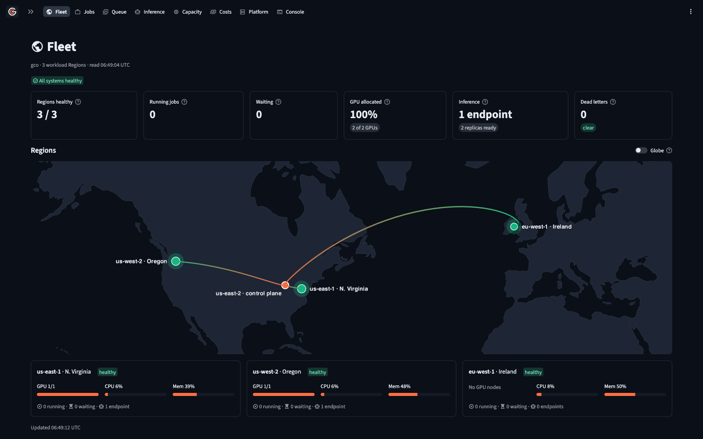

# GCO Dashboard

`gco dashboard` runs a local web UI for a GCO deployment. It shows every
Region on one map with its health and load, and lets you work with Jobs, the
central queue and inference endpoints (with a chat playground). It also
compares capacity and prices across Regions, charts what the fleet costs, and
reads any API route. It runs on your machine and calls AWS with your
credentials, exactly as the matching `gco` commands do. Nothing is deployed
for it.



*The Fleet page of a three-Region deployment.*

## Table of Contents

- [Start it](#start-it)
- [Pages](#pages)
- [What it reads and changes](#what-it-reads-and-changes)
- [Security](#security)
- [AWS charges](#aws-charges)
- [Commands](#commands)
- [Troubleshooting](#troubleshooting)
- [Development](#development)

## Start it

Run the dashboard from a GCO checkout: it reads the deployment's Regions and
project name from the checkout's `cdk.json`, as the CLI does. Pick one of
three ways.

**In its own container** (Docker, Finch or Podman):

```bash
gco dashboard start      # builds the image the first time, then opens the browser
gco dashboard status     # is it running, and its link
gco dashboard stop
```

The first start builds the image from `Dockerfile.dashboard`, which takes a
few minutes. Later starts reuse it until a source file changes. The browser
opens on `http://localhost:8501/?token=...`; that link carries the access
token (see [Security](#security)). `gco dashboard open` opens it again.

**In this process**, if the CLI is installed with the `dashboard` extra:

```bash
pip install -e '.[dashboard]'   # Streamlit, Altair, pydeck and pandas
gco dashboard serve             # Ctrl-C stops it
```

**In the dev container.** Through the `gco` shell function that
[`scripts/setup-dev-alias.sh`](../scripts/setup-dev-alias.sh) installs, the
dev image already has the extra:

```bash
gco dashboard start             # serves in this terminal; Ctrl-C stops it
```

The function publishes the dashboard's port on the host's `127.0.0.1`, at
`GCO_DASHBOARD_PORT` (default `8501`), for `gco dashboard start` and
`gco dashboard serve` only. Each `gco` command runs in a dev container of its
own, so `status`, `open`, `stop` and `logs` there cannot see the dashboard:
it runs in the terminal that started it.

Pass `--project-dir` to point at a checkout other than the current
directory, and `--port` to use another port on the host.

## Pages

The Region filter in the sidebar narrows every page to the Regions you pick.
Auto-refresh re-reads the live views every 15 s to 5 min, and **Refresh now**
re-reads them at once. Most panels end with the `gco` commands that do the
same thing from a terminal.

| Page | What it shows | What you can do |
|------|---------------|-----------------|
| **Fleet** | A world map of the workload Regions with health, running Jobs, queue depth and served endpoints; the fleet's headline numbers; GPU, CPU, memory and active-job history from each Region's health monitor; the findings `gco status` reports; the latest Jobs | Pick the history window |
| **Jobs** | Kubernetes Jobs in every Region: counts by Region and status (click a bar to filter), a timeline of when they ran, and a table you can filter by name and status. A selected Job opens its overview, pods, events, logs (with follow mode), metrics and CLI equivalents | Submit a Job, retry or delete one, and delete finished Jobs in bulk after a preview |
| **Queue** | The central job queue by Region and status, each Region's SQS queue (with its dead-letter count), and the records. A selected record shows its journey through the queue and its manifest | Queue a Job (priority and an optional Spot price gate), cancel a queued one |
| **Inference** | The endpoint registry with each Region's replicas and state. A selected endpoint opens its overview, a chat playground (streamed through the global API or one Region, with time to first token and throughput), health probes of every path to it, and its management controls | Deploy an endpoint (vLLM, SGLang, Triton or a custom image), chat with it, scale it, roll out an image or a canary, stop, start, add or remove a Region, delete it |
| **Capacity** | Each Region's load and where new work would land; for an instance type, where it is offered, its On-Demand and Spot prices, Spot price history, and Spot placement scores | Ask for the best Region for a workload, score Spot placement |
| **Costs** | What the pods cost by namespace, Region and day (OpenCost reports queried with Athena), and, on request, what AWS bills for the project (Cost Explorer, with forecast and cost allocation tag status) | Pick the window and granularity; load and reload the bill |
| **Platform** | The stacks in every Region and each Region's add-on convergence, failures first; the global and regional services; each Region's enforced job policy side by side, with the live ResourceQuota, LimitRange and per-container GPU cap; job templates; webhooks; a topology diagram | Create, run and delete templates; register and delete webhooks |
| **Console** | Any GCO API route, read with your credentials, as a table and as JSON | Send a read, download the answer as JSON or CSV, download the fleet status document |

The submit dialog, shared by the Jobs and Queue pages, takes a manifest from
the checkout's `examples/`, pasted YAML or an uploaded file. It sends the
Job to a Region you pick, to the Region the API recommends, to the central
queue, or to a Region's SQS queue. **Validate** has the Region's API check
the manifests with a dry run first, and the dialog shows the equivalent `gco`
command.

## What it reads and changes

The dashboard reads and writes through the same code as the CLI
(`cli/aws_client.py`, `cli/jobs.py`, `cli/inference.py` and the capacity and
cost modules), so it sees what `gco` sees:

- **Credentials**: the AWS SDK's usual chain, so `AWS_PROFILE`, `AWS_REGION`,
  the `~/.aws` files and SSO all work. The container mounts `~/.aws`
  read-only and forwards the AWS variables by name.
- **Deployment**: the checkout's `cdk.json` (project name, workload Regions,
  global and API Gateway Regions, regional API mode). In regional API mode the
  dashboard has no global API to call, so it reaches each Region's API
  directly and offers no "global" routes.
- **Caching**: each read is cached for 5 seconds to an hour depending on how
  fast its data changes, so moving between pages is instant. Every change made from
  the dashboard drops the live reads it made stale. Reads that cost money or
  have quotas (Cost Explorer, Spot price history, placement scores) keep
  their own cache and reload button.
- **GPU figures**: GPU use comes from each Region's health monitor, which
  counts the GPUs its nodes offer and the GPUs pods request. A Region without
  GPU nodes says `No GPU nodes` instead of showing 0% (an idle GPU it does
  not have) and is left out of the fleet's GPU share and the GPU history
  chart. A health monitor whose cluster reads are failing sends no figures at
  all: the Region's gauges are empty, its card and the Platform page name
  the failed read, and it is left out of the fleet's GPU share.

Every change runs as the signed-in AWS principal, exactly as the matching
`gco` command would, and goes through the same API validation and policies.
Destructive changes (deleting a Job, an endpoint, a template or a webhook,
cancelling a queued Job, removing an endpoint's Region) ask for confirmation
first.

## Security

The dashboard can change the fleet with your credentials, so it is built to
be reachable from your browser and nothing else:

- **Loopback only.** `gco dashboard serve` listens on `127.0.0.1`. The
  container listens on every interface inside its own network namespace, and
  its port is published on the host's `127.0.0.1` only.
- **Access token.** Each start draws a random token. The server admits a
  browser session only when the link's `?token=` matches it, compared in
  constant time, so another local user or a web page in your browser cannot
  drive it without the link. `--no-token` turns this off; it is refused
  whenever the server would listen beyond loopback, including in the dev
  container.
- **Browser protections.** Streamlit's XSRF protection is on, the server
  accepts only the `localhost` and `127.0.0.1` host names (against DNS
  rebinding), static file serving and Streamlit's agent API are off, and no
  usage statistics are sent.
- **The container** runs as your own user ID (with `--userns keep-id` on
  Podman), with a read-only root filesystem, a tmpfs `/tmp`, every Linux
  capability dropped and `no-new-privileges`. `~/.aws` and the checkout are
  mounted read-only. The token reaches the container through an environment
  variable passed by name, never on the command line.
- **The image** is distroless, built the same way as the service images: the
  locked dependency set, Debian security patches, and a minimal root
  filesystem with no shell or package manager. CI scans it with Trivy like
  the other images.

The dashboard's state (mode, port, token, start time) is kept in
`~/.gco/dashboard.json`, readable by you only.

## AWS charges

Most reads are free or cost a fraction of a cent. These are the ones to know:

- **Cost Explorer** charges per API request
  ([pricing](https://aws.amazon.com/aws-cost-management/aws-cost-explorer/pricing/)).
  The Costs page asks it only when you press **Load from Cost Explorer**
  or **Reload**, and keeps the answer for 15 minutes. A write elsewhere in the
  dashboard never re-reads it.
- **CloudWatch** `GetMetricData` charges per metric requested
  ([pricing](https://aws.amazon.com/cloudwatch/pricing/)). The utilization
  history requests a few metrics per Region and is cached for a minute.
- **Athena** charges per byte scanned; the OpenCost reports it reads are
  small Parquet files.
- **Spot placement scores** are free, but AWS limits how many different
  configurations an account can score in 24 hours. They load only when you
  ask and are kept for an hour.

The GCO API calls themselves (API Gateway, Lambda) are the same ones the CLI
makes.

## Commands

| Command | What it does |
|---------|--------------|
| `gco dashboard start` | Start the dashboard in its own container and open it (in the dev container: serve in the foreground) |
| `gco dashboard serve` | Run the dashboard in this process until Ctrl-C |
| `gco dashboard status` | Whether it runs, how, and its link (`-o json` for a document) |
| `gco dashboard open` | Open the running dashboard in a browser |
| `gco dashboard logs` | Print the container's log (`-f` to follow) |
| `gco dashboard stop` | Stop the container |

Every option is in the [CLI reference](CLI.md#dashboard-commands).

## Troubleshooting

| Symptom | What to do |
|---------|------------|
| The page asks for its access link | Open the link `gco dashboard open` or `gco dashboard status` prints. Each start draws a new token, so an old link stops working after a restart |
| "No workload Regions are configured" in the sidebar | Start the dashboard from a GCO checkout, or pass `--project-dir` |
| `gco dashboard serve` says it needs Streamlit | `pip install -e '.[dashboard]'`, or use `gco dashboard start` |
| No container runtime found | Install Docker, Finch or Podman, or use `gco dashboard serve` |
| The port is in use | `--port 8502` (in the dev container, `GCO_DASHBOARD_PORT=8502`) |
| The AWS bill reads $0.00 although the fleet has run for days | Cost Explorer groups the bill by the `Project` cost allocation tag, which must be activated once per payer account: `gco costs allocation activate`. Costs appear about a day after activation |
| A page shows a sign-in hint | Your AWS session expired: sign in again (for example `aws sso login`) and press **Refresh now** |
| The container started but does not answer | `gco dashboard logs` |

## Development

The code lives in [`cli/dashboard/`](../cli/dashboard/):

| Module | Role |
|--------|------|
| `app.py` | The Streamlit entrypoint: page setup, the access check, navigation |
| `app_pages/*.py`, `views/*.py` | One page each: the two-line page file renders its view |
| `data.py` | `FleetData`, the only path to AWS and the GCO API |
| `ui.py` | Cached readers, error cards, confirmations, toasts, the sidebar and shared widgets |
| `frames.py`, `charts.py` | API answers to pandas DataFrames, and DataFrames to Altair charts and pydeck maps |
| `submit.py` | The submit dialog the Jobs and Queue pages share |
| `server.py`, `container.py` | Starting Streamlit, and the dashboard container's lifecycle |
| `brand.py`, `regions.py`, `assets/`, `.streamlit/` | Colours, the icon, Region coordinates, the offline world map and the light and dark themes |

The world map needs no tile server: `assets/world_land.json` holds the
1:110m land polygons of [Natural Earth](https://www.naturalearthdata.com/),
which are in the public domain. Made with Natural Earth.

`gco dashboard serve` is the quickest loop while changing a page; reload the
browser after an edit. The tests drive every page through Streamlit's
`AppTest` against an in-memory fleet (`tests/_dashboard_fakes.py`), so they
need no AWS account:

```bash
pytest tests/test_dashboard_*.py -n auto
```
